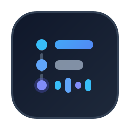

<p align="center">
  
</p>

<h1 align="center">Narrate</h1>

<h3 align="center">将静默的黑盒工具调用，转化为简练、实时的步进式思考播报。</h3>

<p align="center">
  告别干瞪眼等待 AI 连续静默执行十几轮工具调用。<br/>
  <strong>Narrate</strong> 让 AI 编程 Agent 在工作过程中用 1–2 句简练的话实时汇报关键步骤、阶段性发现与下一步动作，让你随时跟进它的思考过程并及时纠偏。
</p>

<p align="center">
  <a href="#快速开始"><strong>快速开始</strong></a> &nbsp;·&nbsp;
  <a href="#效果对比"><strong>效果对比</strong></a> &nbsp;·&nbsp;
  <a href="#工作原理"><strong>工作原理</strong></a> &nbsp;·&nbsp;
  <a href="#全局常驻模式"><strong>全局常驻配置</strong></a> &nbsp;·&nbsp;
  <a href="./README.md"><strong>English</strong></a> &nbsp;·&nbsp;
  <a href="./README_ZH.md"><strong>简体中文</strong></a>
</p>

<p align="center">
  <a href="https://github.com/starsrc/narrate/stargazers"></a>
  <a href="LICENSE"></a>
  <a href="#快速开始"></a>
  <a href="plugin.json"></a>
</p>

---

<a id="快速开始"></a>

## 快速开始

### 1. 安装

#### 方式 A — 通用 Agent Skills CLI（`skills.sh`）

支持 **Cursor**、**Claude Code**、**Codex CLI**、**Google Antigravity** 与 **OpenCode**：

```bash
npx skills add starsrc/narrate -g
```

#### 方式 B — Google Antigravity 原生插件 CLI（`agy`）

直接作为 Antigravity 原生插件安装：

```bash
agy plugin install https://github.com/starsrc/narrate
```

<details>
<summary>更多安装选项（指定单一 Agent、仅安装到当前项目或单次免安装体验）</summary>

非交互式全局安装到指定 Agent（如 Cursor 或 Claude Code）：

```bash
npx -y skills add starsrc/narrate --skill narrate --agent cursor --global --copy --yes
npx -y skills add starsrc/narrate --skill narrate --agent claude-code --global --copy --yes
```

仅安装到当前项目工作区（省略 `-g`）：

```bash
npx skills add starsrc/narrate
```

不安装直接临时体验：

```bash
npx skills use starsrc/narrate@narrate --agent codex
```

</details>

### 2. 在任意任务中使用 `/narrate`

在日常的开发、排障或重构提问前直接加上 `/narrate`（或在提问中提及 `narrate`）：

```text
/narrate 为文件上传接口实现基于 Redis 的滑动窗口限流，并补齐单元测试。
```

```text
/narrate 排查为什么鉴权中间件在刷新 Token 时会丢失 Session Cookie。
```

```text
/narrate 将订单导出的同步接口重构为异步后台任务，并提供导出进度查询接口。
```

---

<a id="效果对比"></a>

## 效果对比

| 未开启 `narrate`（静默黑盒执行） | 开启 `narrate`（实时步进播报） |
| :--- | :--- |
| `Read auth/middleware.ts`<br/>`Grep "refreshToken"`<br/>`Read auth/session.ts`<br/>`Read config/cookies.ts`<br/>`Run npm test`<br/>`Edit auth/session.ts`<br/>`Run npm test`<br/><br/>*（静默等待 2 分钟后才一次性输出大段结论）* | **Agent：** 正在读取 `auth/middleware.ts` 与 `auth/session.ts`，确认 Token 刷新时 `Set-Cookie` 响应头的写入逻辑。<br/>`Read auth/middleware.ts` · `Read auth/session.ts`<br/><br/>**Agent：** 已定位根因：`rotateRefreshToken()` 直接覆盖了 `res.headers` 而非追加 `Set-Cookie`。接下来修改 `auth/session.ts` 并运行鉴权单测验证。<br/>`Edit auth/session.ts` · `Run npm test` |

---

<a id="工作原理"></a>

## 工作原理

现代 Agent 模型在后训练阶段具备 **交错式工具前导播报（Interleaved Tool-Use Preamble）** 能力，但在默认系统提示词下往往倾向于静默连续调用工具，直到最后一步才向用户输出文本。

`narrate` 通过四条轻量高权重准则唤醒模型的实时播报机制：

1. **工具调用交错播报**：在发起 `read_file`、`grep`、`edit_file`、`run_command` 等多步工具调用的同一轮次中，同步输出 1–2 句简明进展。
2. **结论 + 下一步动作**：每次播报清晰回答两件事——**刚刚确认了什么阶段性结论**、**下一组工具调用准备检查或修改什么**。
3. **防刷屏合批纪律**：同一轮次内的并行文件读取或搜索合并为一条简短播报，避免逐文件流水账刷屏。
4. **抑制冗余复述**：对已在界面渲染的设计文档（Artifacts）或代码 Diff 不做重复长篇总结。

---

<a id="全局常驻模式"></a>

## 可选：全局自动调用 `narrate` 技能（写入常驻 Rule）

默认情况下，Skill 采用按需加载或通过 `/narrate` 手动调用。如果你希望 Agent **在所有对话和任务中都自动调用 `narrate` 技能**（无需每次手敲 `/narrate`），只需将以下指令加入全局 `CLAUDE.md`、`AGENTS.md` 或 `~/.gemini/GEMINI.md`，指定 AI 始终加载并遵循 `narrate` 技能即可：

```markdown
- 在执行任何多步任务（调研代码、排查问题、编写或重构代码）时，必须始终调用并遵循 `narrate` skill 进行实时步进播报。
```

---

## 仓库目录结构

```text
narrate/
├── plugin.json               # Google Antigravity 原生插件清单
├── assets/
│   └── logo.svg              # 插件与仓库矢量图标
├── skills/
│   └── narrate/
│       └── SKILL.md          # 核心技能定义（兼容 skills.sh 与 Antigravity）
├── README.md                 # 英文说明文档（默认）
├── README_ZH.md              # 简体中文说明文档
└── LICENSE                   # MIT 开源协议
```

## 开源协议

[MIT](LICENSE)
